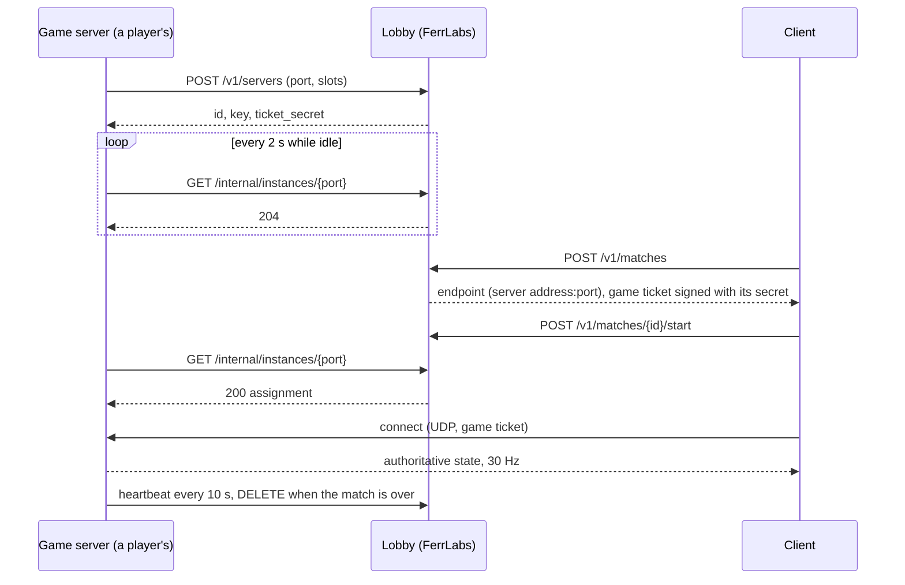
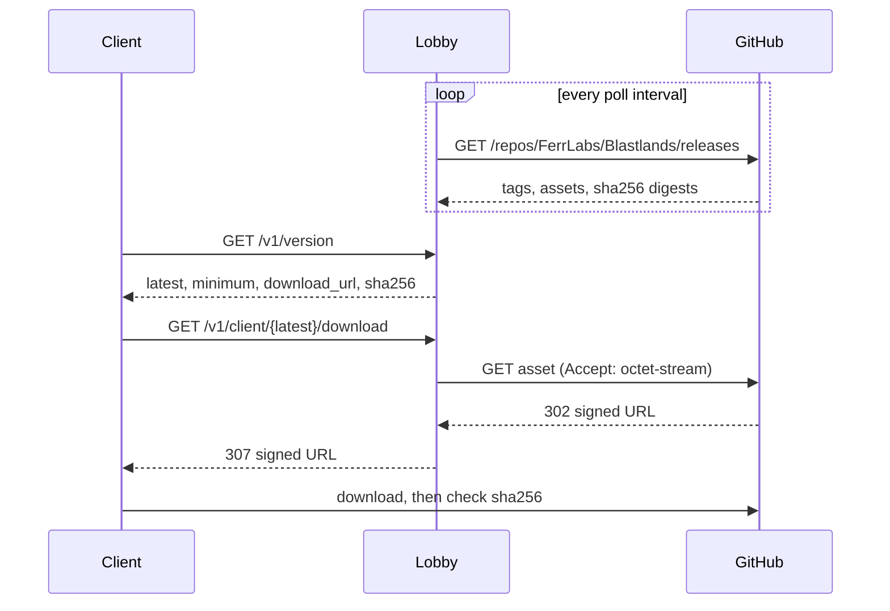
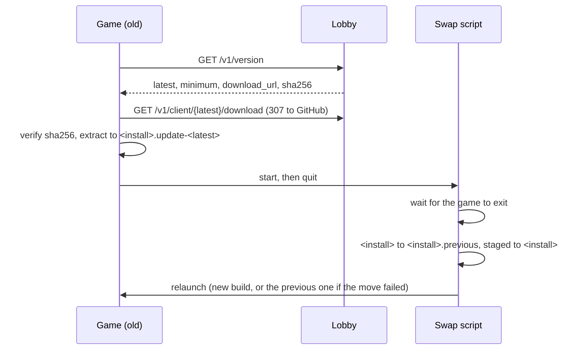
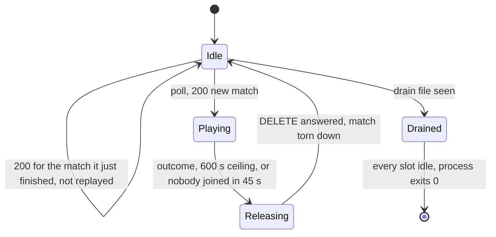

# Architecture

## Who runs the game servers

FerrLabs runs the lobby and nothing else. Every match is played on a game server a player
runs: either the Dedicated Server build on their own machine or VPS, or the game client
itself through **Host on this PC**, which runs one slot inside the player's own process. Both
register themselves with the lobby. The lobby keeps the directory of servers and matches and signs who may join; it
never carries a game packet.

The server stays authoritative, and it is the same Unity project as the client, so the
simulation exists once. What moving it to players costs, and was accepted:

- Whoever runs the server can cheat: it decides who died. Play on servers you trust.
- The server's upload and CPU are every player's ceiling, and a server that quits ends
  its matches.
- Its UDP ports have to be reachable from the internet. There is no relay, so a server
  behind NAT needs those ports forwarded. The lobby probes each slot over UDP before
  sending it strangers' matches (see Deployment), but cannot fix an unreachable one.

## Components

### Lobby service (`server/`, Rust + axum)

Long-lived HTTP service. Owns the match directory: which matches exist, who is waiting,
and where a match's game server lives. It is deliberately dumb about gameplay — it never
sees a bomb.

Responsibilities:

- `GET /` — the download page: an Install button pointing at the installer when the release carries one,
  the zip otherwise, and a disabled one before any build exists. The HTML is embedded in the binary
  (`landing.html`).
- `GET /v1/client/{version}/installer` — redirect to the release's `Blastlands-Setup-<tag>.exe`, like
  `.../download` does for the zip. Only the published version has one, and only if the release carries it.
- `POST /v1/servers` — a game server registers: `{"port": 7777, "slots": 2, "listed": true}`
  with the build's `x-blastlands-version`. The address is the one the request came from,
  never one the caller names, so nobody can point players at somebody else's machine. The
  answer is the server's `id`, a `key` it presents as `Authorization: Bearer` on every
  `/internal/*` call, and its own `ticket_secret`. One address may register
  `BLASTLANDS_LOBBY_SERVERS_PER_ADDRESS` servers (3), and registrations share the create
  rate limit. A server the lobby has not heard from for 60 s is forgotten with its key and
  its matches, and has to register again (`401` tells it so).
- `GET /v1/server/{version}/download` — the published Linux server build
  (`Blastlands-<tag>-server-linux.zip`), redirected like the client download.
- `GET /v1/matches` — public list of matches accepting players.
- `POST /v1/matches` — create a match on a free slot of a registered server, return its
  endpoint. Without `server` the lobby picks any listed server with a free slot; with
  `"server": "<id>"` it uses that one. A server registered with `"listed": false` is never
  picked and only takes a match from a caller presenting its key, which is how a player
  keeps a server to themselves.
  The body may name a `mode`, `arena` (the default), `classic`, `classic_blinded` or `survival`. It is on
  every listing, in the create response, and in the instance's assignment, which the
  slot serving it reads. A client builds the same rules from the mode in its invite, since
  prediction runs them before the first snapshot lands. `bot_skill` (`easy`, `normal` by
  default, or `hard`) travels the same way, and only the server reads it. `max_players` runs from 2 to 8, the most spawns a board generates.
- `POST /v1/matches/{id}/join` — reserve a slot, return the endpoint and a join ticket.
- `POST /v1/matches/{id}/bots` — host-only, claims an open seat for a bot instead of
  waiting for someone to join it. A game server instance already fills every seat nobody
  human took, so this only narrows who may still join and lets a solo host clear the
  `MIN_PLAYERS` floor without a second human.
- `GET /v1/matches/{id}` — one match and whether it has started, which is how a player
  who joined learns the host pressed start: a started match leaves the listing.
- Reap matches whose game server stopped heartbeating.

Every refusal, whatever the layer, answers `{"code": "...", "message": "..."}` as JSON. That
includes a request body axum itself refuses before a handler runs, such as an out-of-roster
`character` or a `name` outside `DisplayName`'s length and character set: a `ValidatedJson`
extractor stands in for `Json<T>` on every route that reads a body and turns axum's own
rejection into the same shape, at axum's own status (422 for a body that parses as JSON but not
into the request type, 400 for one that is not JSON at all). Without it, that one path breaks the
contract every other refusal keeps, and a client reading for a code and finding none has no way
to tell "you sent something wrong" apart from "I could not read that at all".

### Join tickets

The lobby signs a game ticket for every player it admits: the host gets one in
`game_ticket` when creating the match, a joining player gets one in `ticket`. The `ticket`
returned by create is something else, the host's key for `POST /v1/matches/{id}/start`.

A game ticket is six dot-separated fields, or seven when the player chose a character:

```
v1.<match id>.<player name, hex of its UTF-8>.<expiry, unix seconds>.<nonce>.<HMAC-SHA256, hex>
v2.<match id>.<player name, hex of its UTF-8>.<character>.<expiry, unix seconds>.<nonce>.<HMAC-SHA256, hex>
```

The HMAC covers every field before it and uses the `ticket_secret` the lobby gave the
server the match is on, as UTF-8 bytes. Every server gets its own at registration, so a
server can admit players to its own matches and to nobody else's.

The character is optional in both `POST /v1/matches` and `POST /v1/matches/{id}/join`
(`"character": "demolisher" | "runner" | "grenadier" | "sapper"`). Without one the lobby
still signs a `v1` ticket, so a game server that only reads `v1` keeps admitting everybody
whichever image rolls out first. Being signed, the character cannot be swapped between the
lobby and the door. The instance hands it to the seat the connection takes, before the first
tick only and only in a mode with characters; a reconnect mid-match keeps the kit it had.

A ticket is issued when its holder joins but spent when the match starts, so its lifetime
is tied to the match rather than to the player: a match that has not started within
`BLASTLANDS_LOBBY_WAITING_TTL_SECONDS` (900 by default) is reaped whoever is in it, and a
ticket lives that long plus two minutes to connect. Any ticket for a match that can still
start is therefore still valid when it does.

Match and server state is in-memory for now. It is intentionally not in Postgres: a match's lifetime
is minutes, nothing about it is worth surviving a restart, and a restart during a match
only costs the lobby listing — running matches keep running because clients already hold
their server endpoint, and each server registers again on its next `401`. If persistence is ever needed (stats, history), that is a separate
store, not this one.

### Game server (`client/`, Unity Dedicated Server build)

The same Unity project as the client, built for the Dedicated Server platform (headless
Linux, no rendering), run by players. One process carries up to 16 matches side by side,
one per port.

It runs the authoritative simulation and is the only thing allowed to decide that a player
died. Clients send inputs; the server sends state. Bots are just players whose inputs come
from `BotBrain` instead of a socket — the simulation cannot tell the difference, which is
what keeps them honest.

Building the server from the same project as the client is the point: gameplay code exists
once. A separate Rust game server was considered and rejected — it would mean writing every
bomb, blast and power-up rule twice, in two languages, and keeping them bit-identical
forever.

It starts itself. `ServerBootstrap` runs on load in a server build, so there is no scene to
wire and no inspector to fill in. What stays the same for the life of the process comes from
`HostOptions`: the first port (`--port` or `BLASTLANDS_PORT`, 7777 by default), how many
slots it carries (`--slots` or `BLASTLANDS_MATCHES_PER_SERVER`) and the lobby (`--lobby` or
`BLASTLANDS_LOBBY`, the FerrLabs lobby by default). Its key and ticket secret come from
registering on startup, and again whenever the lobby answers `401`. An argument
beats the environment, and a bad value refuses to start rather than guessing: a wrong port
collides with a neighbour. What changes from one match to the next, the match id, the seats,
the mode and the bots, arrives with each assignment and is checked by
`ServerOptions.TryCreate` before the slot builds anything. A wrong match id releases somebody
else's match.

A process hosts several matches at once, each with its own `MatchState`, its own
`NetworkManager` and `UnityTransport` bound to its own port, and its own `ServerLoop`. They
share the engine, the main thread and the 30 Hz frame, and nothing else. Netcode keeps one
`NetworkManager.Singleton`, which several managers overwrite; the game never reads it, and
named messages go through each manager's own `CustomMessagingManager`, so a match only ever
hears its own clients.

The guard is `UNITY_SERVER`, which Unity defines for the Dedicated Server subtarget itself,
rather than a hand-added `SERVER` define somebody has to keep in step with `build.yml`. It
only covers what is specific to a headless process: `ServerBootstrap` starting the server on
load, and `LocalMatchDriver` switching itself off, which leaves the client scene inert since
the view, HUD, camera and fog are only ever built when that driver binds them. The server
itself (`ServerHost`, `MatchSlot`, `ServerLoop`, `LobbyRegistrar`, `LobbyReporter`) is in
every build, because the client runs it too.

What separates the two is `HostOptions.Role`, decided at runtime. `Dedicated`, the only role
`ServerBootstrap` builds, owns the process: it pins `Application.targetFrameRate` to the tick
rate, watches the drain file and calls `Application.Quit` once drained or when the lobby
refuses its registration. `InGame` owns none of that, because the process belongs to a
player who is also rendering a match: a refused registration is recorded as
`LobbyRegistrar.Problem` and shown in the lobby instead.

#### Host on this PC

The client's **Host on this PC** button (on the setup page, next to **Create**, which still
means "any listed server") builds `HostOptions.InGame()`: one slot on `--port` or
`BLASTLANDS_PORT` (7777 by default), against the same lobby, never drained. Then:

1. `InGameServer.Ensure` starts a `ServerHost` on a `DontDestroyOnLoad` object, once per
   process, and keeps it for the next match. It registers with `"listed": false`.
2. The lobby offers a slot only after it has polled, so the client waits for the slot's
   first `GET /internal/instances/{port}` under the current registration.
   `LocalHostDecision` makes that call: create once registered and polled within the
   lobby's readiness window, give up on a refused registration, on a slot still playing the
   previous match, or after 30 s.
3. `POST /v1/matches` carries `"server": "<id>"` and the server key as
   `Authorization: Bearer`, which is what an unlisted server requires.
4. The host's own client dials `127.0.0.1` rather than the endpoint the lobby returns
   (`MatchInvite.Via`): that endpoint is the public address, and many routers do not loop a
   LAN client back through its own public IP. Everybody else joins from the list as usual.

The server and the host's client are two `NetworkManager`s in one process, the same
arrangement as several slots in one dedicated process, with one manager connecting to the
other over loopback. The server object survives the Lobby to Match scene load because it
lives on a `DontDestroyOnLoad` root. Closing the game ends the match for everyone in it.

Exit codes are what a supervisor reads: 0 for a match that resolved, 1 for options it would
not start on, 2 for a match that failed to start or ran out its clock without resolving.
Anything non-zero has to mean failure, or a crash loop reads as a clean shutdown and the
match is never released.

### Client (`client/`, Unity Standalone build)

Renders, reads input, predicts local movement, reconciles against server state.

Presentation reads the simulation, never the other way round. Character animation is the
case where that is easiest to get wrong, so it is worth stating: the animator is told what
the player did last tick, and is never allowed to move anyone. Root motion is off on every
character, and the in-place clips (`Walk_Static`, `Run_Static`) are the ones selected, so a
stride cannot displace a transform the simulation owns down to the sub-tile unit. A player
who animates their way off their own position is a player the server will disagree with.

The stride rate is a ratio of the ground the simulation actually moved someone over
against the speed the clip was authored at, which is why `MatchView.runClipSpeed` exists.
Swapping animation packs means measuring that number again rather than accepting whatever
skating falls out.

**Remote players are drawn a few ticks in the past.** Snapshots arrive at the tick rate with
jitter and loss, so drawing each one as it lands makes everybody else stutter. `PlayerTrail`
keeps the last second of snapshot positions and `InterpolationClock` runs a render time three
ticks behind the newest one; remote players are placed between the two snapshots around that
time. A lost snapshot is bridged by its neighbours, a jump of more than a tile per tick (a
wall regrowing on someone) is held and then snapped rather than slid across the board, and
the clock never runs past the newest snapshot, so it holds instead of guessing. It steers by
a tenth of its speed to stay on the delay and only jumps when it has fallen far behind.

Bombs and flames are not delayed. They come from the newest snapshot and are aged by the
server ticks the clock says have passed since it (`SnapshotAge`), never by local time: a fuse
keeps counting and a flame goes out on its server tick through a short loss burst, and a
flame is never shown later than the snapshot that carries it.

**The local player is predicted, not delayed.** `ClientPrediction` keeps a second
`MatchState` and runs `MatchSim.Tick` on the input the moment it is sent, so pressing right
moves the character on that frame instead of a round trip later. Every sent input is kept
until a snapshot acknowledges it. When one lands, the predicted state is overwritten with the
server's (through `SnapshotCodec`, the copy is free of anything the wire does not carry) and
the unacknowledged inputs are replayed on top. A tick whose input never reached the server is
replayed the way the server fills it, movement repeated without the buttons, so the client
does not invent a bomb the server never saw. Remote seats are replayed as standing still;
they are drawn from the trail, not from the predicted state, so that guess never shows.

The correction is smoothed rather than snapped. `CorrectionSmoother` keeps the difference the
replay produced as an offset on the drawn position and works it off by a quarter per tick, so
the character is still drawn where it was the frame before. A divergence of more than a tile
is snapped instead, because sliding a player a tile across a board where a tile is the
difference between alive and dead would be a lie. The camera follows the predicted state, or
it would trail the player by the latency it exists to hide.

This is only tractable because `Core/` is deterministic and engine-free: the replay is the
same code the server ran, on the same inputs, and must reach the same position.

## The simulation core

`client/Assets/_Game/Core/` is plain C# with **no `UnityEngine` dependency**. This is a hard
rule, enforced by the assembly definition and by the fact that `tests/` compiles the same
sources under plain .NET.

Two things fall out of it:

- CI runs the gameplay tests with `dotnet test`, in seconds, with no Unity licence and no
  10 GB editor image. Only builds and PlayMode tests need the licence.
- The simulation is deterministic and engine-independent, which is what makes
  client-side prediction and server reconciliation tractable: both sides run the same code
  on the same inputs and must agree.

Determinism rules for anything under `Core/`:

- Integer grid coordinates and fixed-point sub-tile positions. No `float`, no `Vector3`.
- No `System.Random` without an explicit seed carried in the match state.
- No wall-clock time, no `DateTime.Now`. Time is a tick counter.
- No iteration over unordered collections where order affects outcome.

## Match lifecycle



Other clients see the match via `GET /v1/matches` between creation and start, and join the
same way.

The Match scene carries both drivers: `LocalMatchDriver` for a practice session against
bots on this machine alone, `NetworkedMatchDriver` for the match above. `MatchHandoff`
decides between them, a static the lobby screens leave an invite in on their way to
`SceneManager.LoadScene`. `LocalMatchDriver` stands itself down when one is waiting, so it
never builds its own arena and its own bots on top of the match the lobby just set up.
Opening the Match scene directly, with no invite left, is what runs a local practice
session or reproduces a bug from its seed.

The game server admits a connection only through Netcode's connection approval, with the
game ticket as connection data. `GameTicketVerifier` refuses a ticket that is malformed,
signed with another key, issued for another match, past its expiry, or already used by an
earlier connection. Expiry is the one place the game server reads the wall clock; it
decides who gets in, not what happens in the simulation. The key is the `ticket_secret`
from the server's registration, and changes when it registers again.

## Updating the client

There is no launcher, so nothing else can update the game. That makes the update path part
of the architecture rather than a packaging detail.

The failure it exists to prevent is not "the player misses a feature". It is an outdated
client joining a current match: the simulation is deterministic and lockstep-ish, so a client
running different rules **desyncs silently** rather than failing loudly. Everyone's match is
quietly wrong. Refusing that client up front is the whole point.

**The lobby is the gate.** `GET /v1/version` returns:

```json
{ "latest": "26.9.0", "minimum": "26.8.0",
  "download_url": "https://api.blastlands.ferrlabs.com/v1/client/26.9.0/download", "sha256": "…" }
```

**`latest` comes from GitHub, not from configuration.** Every `BLASTLANDS_RELEASE_POLL_SECONDS`
(300 by default) the lobby lists the repository's releases with `BLASTLANDS_GITHUB_TOKEN` and
keeps the highest version, drafts and prereleases excluded, that carries
`Blastlands-v<version>-windows.zip`. `sha256` is the digest GitHub computes on that asset.
FerrFlow cuts the release before `build.yml` attaches the archive, so for the hour in between
the lobby keeps announcing the previous build rather than one nobody can download.

Until the first read succeeds, `/v1/version` answers **503** `release_unknown`, which the client
treats like an unreachable lobby.

**The repository is private**, so a player cannot fetch the asset directly.
`GET /v1/client/<version>/download` asks GitHub for the asset with the lobby's token and
answers **307** to the short-lived signed URL GitHub hands back. That link is reused for 60
seconds, well inside the roughly 40 minutes GitHub signs it for, so the API calls stay at about
one a minute however many players update at once: every call spends the same hourly quota as
the release poll, and a download per call would let a release-day crowd exhaust it. The version is in the path on
purpose: a client that read 26.9.0 and its hash gets a 404 rather than 26.9.1 if a release
lands in between, instead of a download that fails its hash check for no visible reason.



Every client sends `x-blastlands-version` on match create and join. Below `minimum` the lobby
answers **426 Upgrade Required** — a status that says "this would work on a newer build",
which is exactly the signal an updater needs. A missing or malformed header is a 400: a client
that does not identify itself is either ancient or not ours.

Two deliberate asymmetries:

- `GET /v1/version` is **ungated**. A client too old to play still has to be able to ask what
  to upgrade to, or it is stuck with no way out.
- A client **newer** than `latest` is allowed in. A developer build must not be locked out by
  its own lobby.

`minimum` moves only when the wire format or the simulation rules change, which is a decision
rather than a consequence of a build, so it stays `BLASTLANDS_CLIENT_MINIMUM` in the lobby's
configuration. A new release alone offers an update; bumping `minimum` forces one.

**Applying the update.** `ClientStartup` asks the lobby on every launch of a player build,
against `https://api.blastlands.ferrlabs.com` unless `--lobby <url>` says otherwise. Below
`minimum`, a Windows player updates itself; between `minimum` and `latest` the update is
offered and the player takes it with `F5`. Other platforms never self-update: the release
publishes a Windows archive only.

**Installer.** Each release also carries `Blastlands-Setup-<tag>.exe`, built by `installer/Blastlands.nsi`
(NSIS, on the publishing job). It installs for the current user under `%LOCALAPPDATA%\Programs\Blastlands`,
adds Start menu and desktop shortcuts and an entry in Windows' installed apps, and needs no administrator
rights. The game itself goes in a `Game` folder and the uninstaller beside it, because the updater replaces
the whole game folder and would take an uninstaller inside it along. The zip stays: it is what the updater
downloads and checks. Neither file is code signed, so SmartScreen warns on the first launch.

**Version and update button.** The lobby screens show the running build in the bottom right
corner. When the lobby announces a newer one, an Update button with a download icon appears
above it and starts the same `ClientUpdater` the `F5` key does, so the download, the SHA-256
check and the swap are unchanged. It is greyed while a download runs, and where a build cannot
replace itself (the editor, anything but a Windows player) it only says the new version is out.
`UpdateBadge` decides the text and whether it can be pressed, and is tested without Unity.

**What the player is told.** `UpdateBanner` draws the verdict on an overlay of its own, so a
build that cannot join a match says so on screen instead of only in the log. Below `minimum`
the banner dims the game behind it; between `minimum` and `latest` it sits at the top and the
game carries on underneath. The text comes from `UpdateNotice`, which turns the verdict and the
updater's `UpdateStage` into a headline and a line of detail and is tested without Unity. The
ways an update does not simply run are kept apart because the player can act on each
differently: nothing published yet means wait, a platform that cannot replace itself means
install by hand, and a failure names its reason, a SHA-256 mismatch included. The overlay is
deliberately plain. The lobby screens in #7 own the real chrome, and the notice is theirs to
restyle.

On Windows a running executable cannot replace itself, so `ClientUpdater`:

1. downloads the archive to the temporary cache directory, never over the install;
2. checks it against the published SHA-256 and stops on a mismatch. Installing whatever was
   downloaded would be a remote code execution vector, so this is not optional;
3. extracts it into a sibling of the install, `<install>.update-<version>`, refusing any entry
   that is absolute or climbs out with `..`, and any that would land past Windows' 260-character
   path limit there. The same depth check runs on the current install before the download, so a
   game unzipped somewhere too deep says so instead of fetching an archive it cannot unpack;
4. writes a PowerShell script, starts it and quits.

The script waits for the game to exit, renames the install to `<install>.previous`, renames the
staged build into its place and relaunches. If the new build cannot be moved in, the previous
one is moved back and relaunched, so a failed swap never leaves nothing to run. The previous
build is kept until the next update replaces it.



## Deployment

**FerrLabs runs the lobby only.** `ghcr.io/ferrlabs/blastlands/lobby` is a Deployment behind
Traefik in `products/blastlands/` of [FerrLabs/Infra](https://github.com/FerrLabs/Infra),
built and published by `docker.yml`. There is no game server in the cluster and no UDP port
on it.

**Running a server.** A release carries `Blastlands-<tag>-server-linux.zip`, downloadable
through the lobby at `/v1/server/<version>/download`. Unzipped, `./Blastlands.x86_64
-batchmode -nographics --port 7777 --slots 2` registers with
`https://api.blastlands.ferrlabs.com` and serves two matches at once on UDP 7777 and 7778,
which have to be reachable from the internet. `build.yml` still wraps the same build in
`ghcr.io/ferrlabs/blastlands/server` for whoever prefers a container.

**Each slot asks which match it has.** A process carries up to 16 slots, each owning one
port for the life of the process. What changes from one match to the next is which match a
port is serving, so the slot is the one that asks, with its server's key:

```
GET /internal/instances/{port}   Authorization: Bearer <key>
  204  nothing assigned yet, ask again
  200  {"match_id": "...", "players": 4, "humans": 3}
  401  the lobby forgot this server: register again
```

The key names the server and the path the port, so two servers on the same port never see
each other's match. Only a started match answers. Before the host presses start there is
nobody to play against, and an instance booted early would spend its grace window on an
empty arena.

`players` is every seat the host opened and `humans` how many joined. The instance builds
all of them, waits for the humans only, and a bot plays any seat nobody is connected to:
the ones nobody took, and a player's seat for as long as they are disconnected.

A client is told that shape rather than configured with it. The seat message that admits
a connection carries the seat, the board's width and height and the player count, and the
client builds its match from those, once, before it renders anything. It has no board
until then, so a snapshot that overtakes the seat message is dropped rather than applied
to a board built on a guess. The alternative, both ends carrying the same numbers by hand,
fails silently: the snapshot refuses a board of a different size rather than writing tiles
into the wrong rows, so the match looks connected and stands perfectly still.

`MatchSlot` is that loop, inside the process: it polls, and on an answer builds the match
and runs it on its port. How many slots a process can carry is a question of CPU as much as
memory: every match in it ticks on the one main thread.



A slot that is `Playing` or `Releasing` when the drain file appears finishes first, then
reaches `Idle` and stops there, which is what the process waits for. In the container, the
entrypoint writes `BLASTLANDS_DRAIN_FILE` on `SIGTERM`, so stopping it lets the matches it
is playing finish.

**A listed slot proves it is reachable first.** Every HTTPS call a server makes goes
outbound, so a server whose UDP ports nobody can reach would register, poll and heartbeat
like any other and soak up public matches nobody can join. While an idle slot is unproven,
each poll makes the lobby send a datagram `blastlands-probe:<nonce>` to the server's public
address on that port. The idle slot listens on its own port (`ProbeListener`, closed before
the match binds the port) and sends the nonce back on its next poll as
`?probe=<nonce>`. Only then does `POST /v1/matches` without a `server` put a match on it.
The nonce is per registration; the probe tests the same inbound UDP path players use, and the
lobby only ever sends, so the cluster needs no UDP ingress. A server somebody chose by id,
an unlisted one included, is not held to it: whoever chose it may still try.

**The lobby only offers live slots.** A slot polls every two seconds while idle and not at
all while it is running a match, and the lobby only hands out a port whose slot polled within
`INSTANCE_READY_TTL` (15 s), so a busy slot or one whose process died is not offered.
Registering does not count as one: after a lobby restart a server registers again while some
of its slots may still be playing a match the lobby forgot. The widest gap between two polls is
`BLASTLANDS_POLL_SECONDS` (2) plus the request's 10 s timeout, and `HostOptions` refuses an
interval above 4 s to stay under the TTL. A running match heartbeats every 10 s, which keeps
its server registered while none of its slots polls.

A finished match returns its slot to polling rather than ending anything, so the process
outlives every match it plays. A match that goes wrong, a bind failure or one that ran out
its 600 s ceiling, is released, logged as an error, and its slot carries on; the other slots
never notice. A crash of the process, meaning any non-zero exit, ends it.

**The server reaches the lobby over HTTPS.** `insecureHttpOption` is `NotAllowed` in the
project settings, so the player refuses a cleartext URL. That is why the `/internal/*`
routes are public, and why they are guarded by each server's key.

A slot also refuses the match it has just finished. Seeing the same id again means the
release never landed, and replaying it would run a finished game on a loop; stalling instead
lets the lobby's reaper free the port. An assignment it cannot start, a seat count the board
cannot hold or a mode it does not know, is refused the same way and logged with the reason.

The lobby needs no Kubernetes client and no RBAC: it decides which slot serves what, and
says so when asked. The client treats the game server endpoint as opaque, so where a server
runs never reaches it.

Nothing here touches `FerrLabs-Cloud/api` or the `Kit` crates. Like FerrGames, Blastlands is
standalone: its own service, its own state, no shared back-office, no accounts. It is a
FerrLabs project at the brand level.
